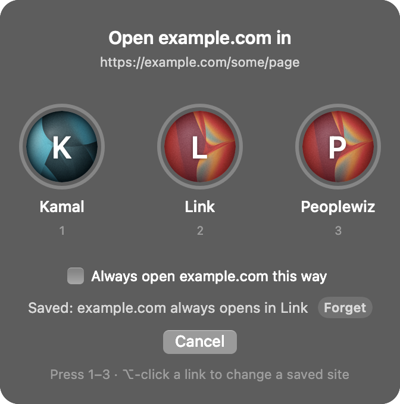

# Finicky Picker

On a Mac, links from Slack, WhatsApp, Claude and other apps open in whichever browser profile is in front, not the one they belong to. Finicky Picker asks you which profile to use and can remember the answer for that site.



- A link from another app shows your profiles, with the same avatars as your browser. Click one or press 1, 2, 3.
- Tick "Always open this site this way" and that site skips the popup from then on. Leave it unticked for sites you use in several profiles, like github.com.
- Hold Option while clicking a link to get the popup again, to pick a different profile or press Forget on a saved site.

It works with [Finicky](https://github.com/johnste/finicky), which does the routing: sites you've saved, and any fixed rules you write, open straight away; everything else goes to the picker. Works with Comet and Google Chrome.

## Install

Needs macOS with the Xcode command line tools (`xcode-select --install`) and Finicky 4:

```sh
brew install --cask finicky
git clone https://github.com/kamal0808/finicky-picker
cd finicky-picker
./install.sh                          # uses Comet if installed, else Chrome
./install.sh --browser "Google Chrome"  # or pick one
```

Then open Finicky once and let it become your default browser.

If you already have a `~/.finicky.js`, the installer backs it up to `~/.finicky.js.bak` and writes a new one; copy your old rules into the new file's handlers.

## Fixed rules

Saved sites live in the `learned` block of `~/.finicky.js`; the picker edits it for you. For rules by pattern, add a handler above the learned one:

```js
{ match: ["*.mycompany.com/*"], browser: profile("Work") },
```

Profile names are the ones in your browser's profile menu.

## Known limits

- One browser at a time.
- Comet avatars come from fixed resource ids inside Comet; a Comet update can move them, and the picker then shows coloured circles instead.
- Saved sites open through Finicky directly, so they may open without bringing the browser window to the front.

Made from an idea on [Ideato](https://www.ideato.social/idea/568b7025-083b-4f47-8a0c-e4912da28894). MIT licensed.
